# CricketIQ — Exploratory Data Analysis

Reproduce: `pip install pandas numpy matplotlib seaborn scikit-learn && python3 eda/eda.py`
(figures → `eda/figures/`, key numbers → `eda/summary.json`).

## 1. Datasets

| Dataset | Size | Source | Use |
|---|---|---|---|
| `icc_all_players.json` | 1,162 players · 1,684 player-event rows | Computed from Cricsheet ball-by-ball (528 men's matches; qualifiers excluded) | ICC archive page |
| `players.json` | 104 curated players | Hand-curated career profiles | Recommender / CRIC-SELECT |
| `tournaments.json` | 31 editions | ICC records | Hall of Fame |

**Data quality:** 0 missing values and 0 duplicate player ids in the archive. Cricsheet is missing a few historical matches, so some totals are slightly below official records (e.g. Kohli: 35 ODI WC matches vs 37 official). Names are Cricsheet short names ("V Kohli").

## 2. Coverage
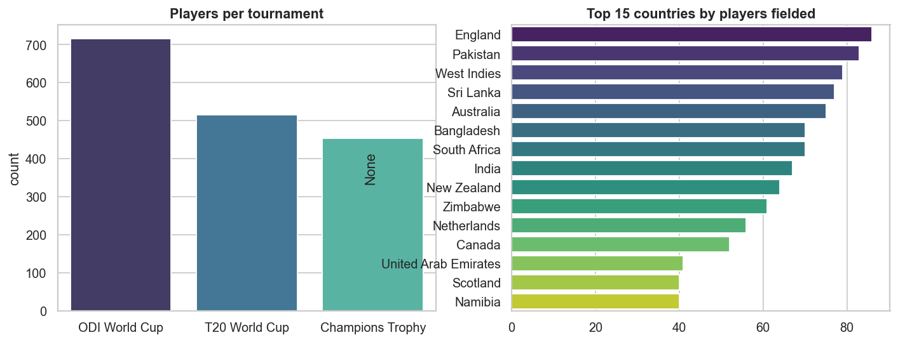
- ODI WC has the most players (716), then T20 WC (515), Champions Trophy (453).
- England (86), Pakistan (83), West Indies (79), Sri Lanka (77) and Australia (75) field the most distinct players — long-running teams with high squad turnover.

## 3. Batting distributions
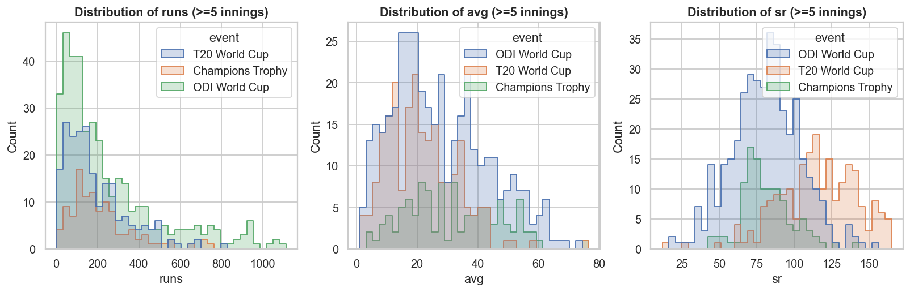
- Runs are heavily right-skewed: most players score little, a handful score thousands.
- Format drives the shape of the data (see §4); mixing formats without normalising would bias any model.

## 4. Format effect
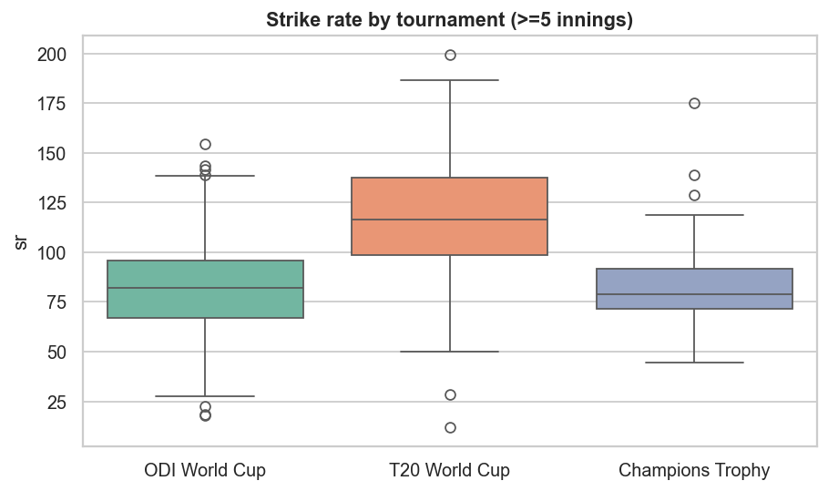

| Metric (median, ≥5 inn / ≥20 ov) | ODI WC | T20 WC | Champions Trophy |
|---|---|---|---|
| Strike rate | 82.0 | 116.6 | 78.8 |
| Batting average | 24.8 | 20.0 | 31.5 |
| Bowling economy | 5.23 | 7.56 | 4.80 |

**Insight:** T20 strike rates are ~42% higher than ODI while averages are lower — scoring is faster but less sustained. Champions Trophy has the highest averages and lowest economy, reflecting a small field of top teams and fewer weak-opposition matches.
→ *The recommender scores players per format and uses format-specific weights for this reason.*

## 5. Average vs strike rate
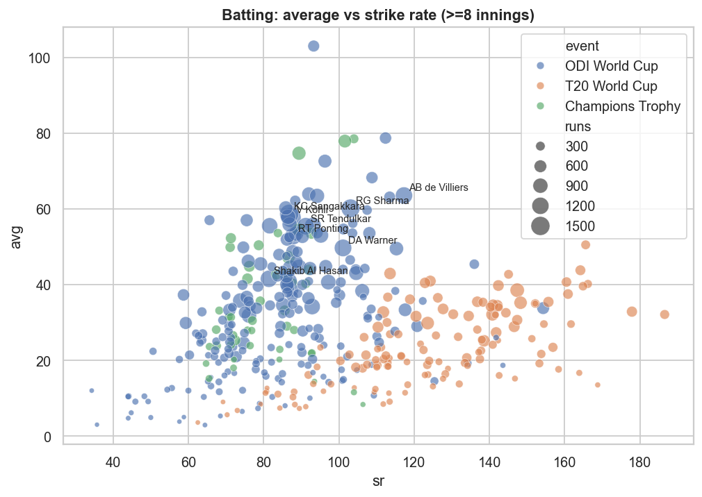
- Two clear clusters: ODI/CT batters (SR 70–110, avg 30–65) and T20 batters (SR 120–180, avg 15–45).
- The upper-right outliers (e.g. AB de Villiers, RG Sharma) combine both — the "elite" quadrant used by the app's scatter plot.
- Correlation between average and strike rate is only **0.25**, so they are genuinely different skills.

## 6. Top performers
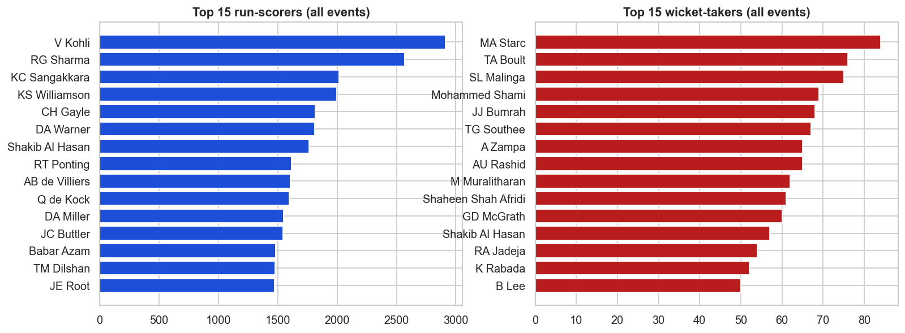
- Runs: V Kohli 2,911 · RG Sharma 2,569 · KC Sangakkara 2,018 · KS Williamson 1,997 · CH Gayle 1,814.
- Wickets: MA Starc 84 · TA Boult 76 · SL Malinga 75 · Mohammed Shami 69 · JJ Bumrah 68.
- Volume stats favour players with long careers and many events; the model therefore blends volume with rate stats (avg/SR/economy).

## 7. Bowling
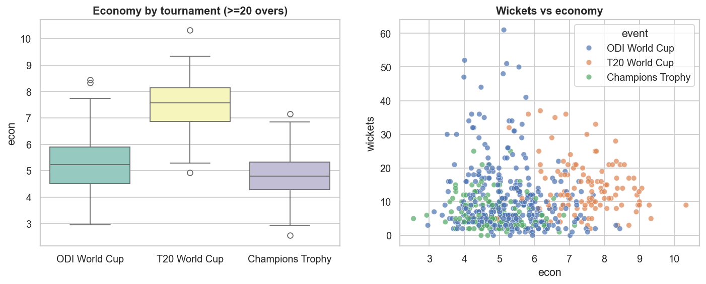
- Economy ordering mirrors batting: T20 ≫ ODI > CT. Wicket-takers sit mostly at economy 4.5–6.5 in 50-over events.

## 8. Correlations
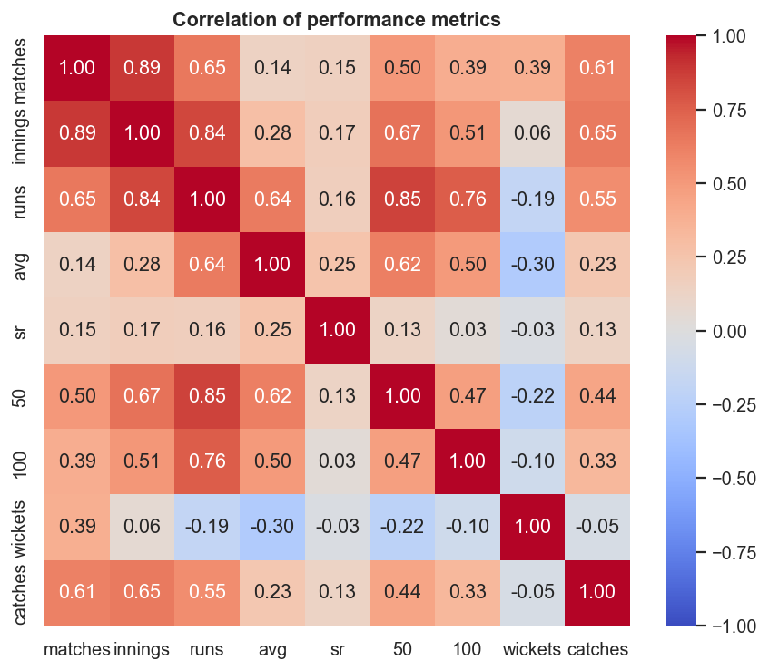
- Runs ↔ matches **0.65**: exposure is the strongest driver of totals — a reason to prefer per-match/rate features for fair comparison.
- Fifties/hundreds track runs very strongly (redundant for modelling); wickets are almost uncorrelated with runs (specialist split).

## 9. Player archetypes (unsupervised)
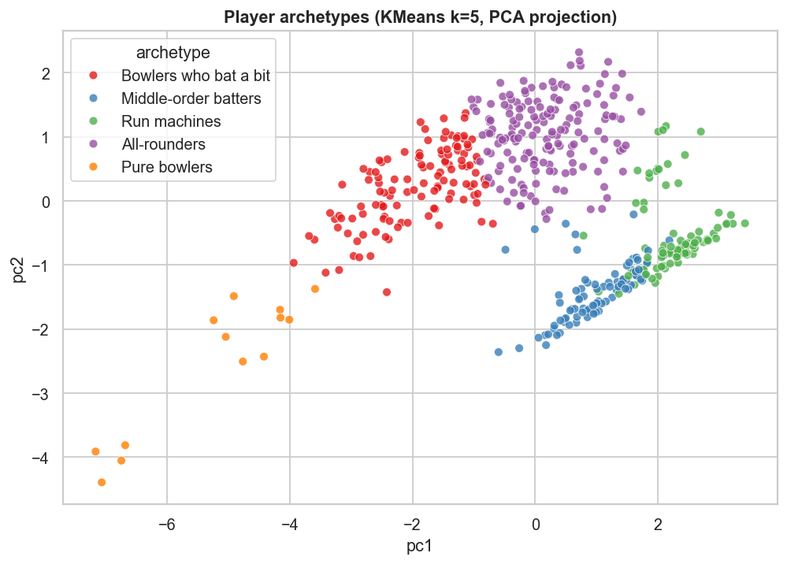

KMeans (k=5) on log-scaled runs, wickets, avg, SR, economy and catches for players with ≥8 matches, projected with PCA:

| Archetype | Players |
|---|---|
| All-rounders | 168 |
| Bowlers who bat a bit | 121 |
| Run machines | 86 |
| Middle-order batters | 85 |
| Pure bowlers | 13 |

The clusters line up with the roles used in the app (batter / all-rounder / bowler), supporting the role-aware scoring and "similar players" features.

## 10. Eras and trophies
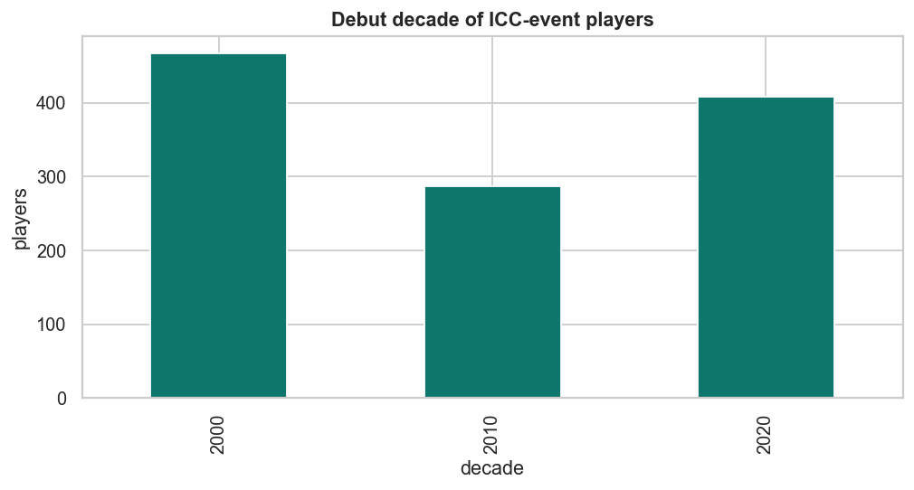 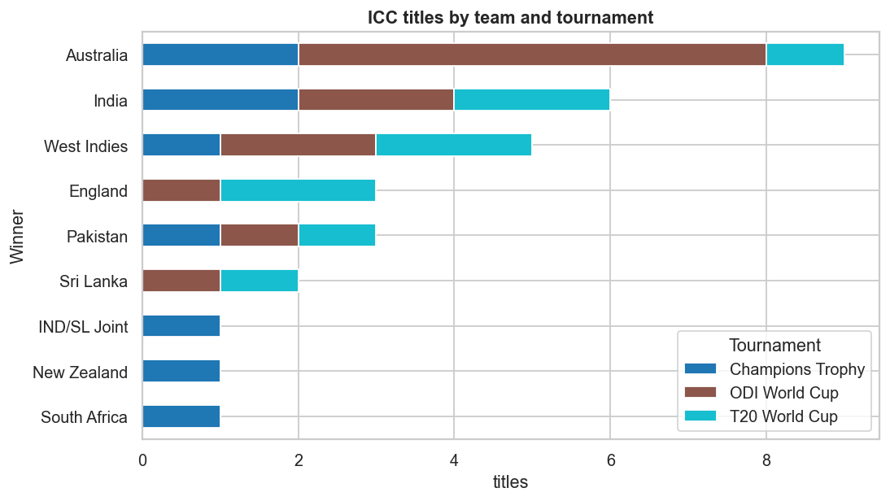
- The player pool is dominated by post-2000 debutants (T20 WC and CT growth plus better ball-by-ball coverage).
- Titles: Australia 9, India 6, West Indies 5, England 3, Pakistan 3.

## 11. Curated recommender set
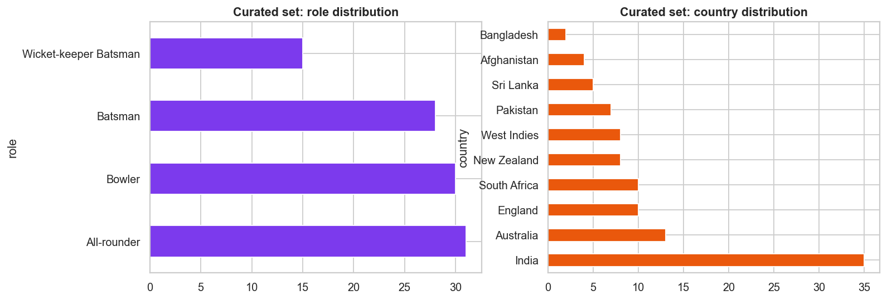
- 104 players: 31 all-rounders, 30 bowlers, 28 batters, 15 keeper-batters — a balanced pool for XI selection.

## 12. Concentration of performance
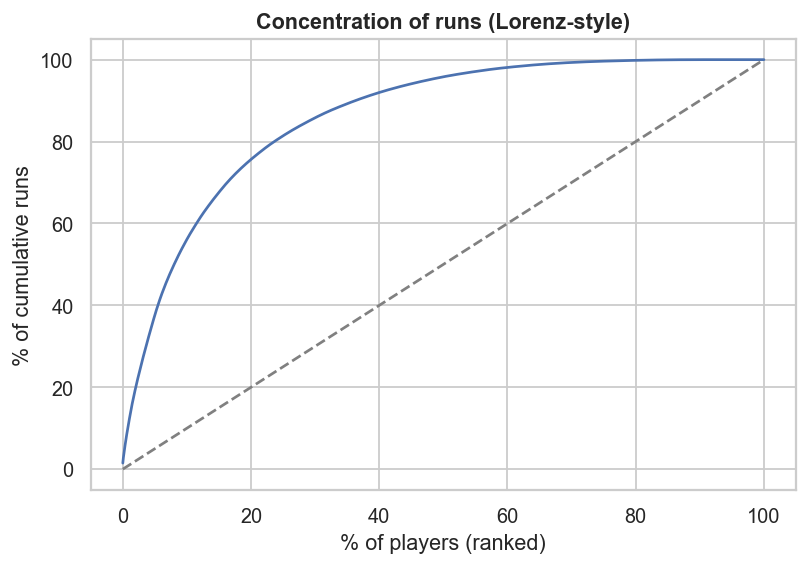
- The top 10% of players account for **55.9%** of all runs — a few stars carry most output, so shortlist quality matters more than breadth.

## 13. Takeaways for the model
1. Normalise per format; never compare raw SR/economy across T20 and ODI.
2. Use rate stats (avg, SR, economy) plus a capped volume term to avoid rewarding sheer longevity.
3. Keep roles distinct — wickets and runs are nearly independent skills.
4. Small-sample players (<5 innings) are noisy; the archive page and EDA apply minimum-innings filters.
5. Extend the recommender to the 1,162-player archive using the same features.
